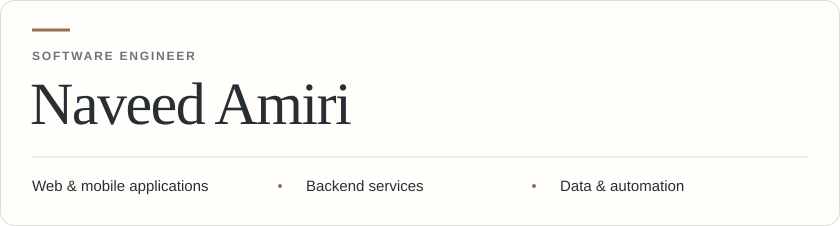
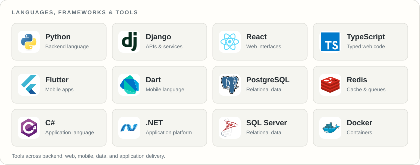
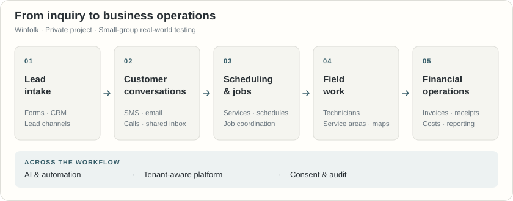
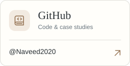

<picture>
  <source media="(prefers-color-scheme: dark) and (max-width: 600px)" srcset="assets/profile-header-mobile-dark.svg">
  <source media="(max-width: 600px)" srcset="assets/profile-header-mobile.svg">
  <source media="(prefers-color-scheme: dark)" srcset="assets/profile-header-dark.svg">
  
</picture>

**Based in Texas, United States.**

I build business software that connects customer workflows, service delivery, and financial operations. My work spans APIs, web and mobile interfaces, and the data and background processes behind them.

Python and Django, React and TypeScript, and Flutter and Dart are central to my current work. My broader experience also includes **C#, .NET, and SQL Server**.

[Systems I Build](#systems-i-build) · [Technical Range](#technical-range) · [Winfolk Case Study](#winfolk--product-case-file) · [How I Engineer](#how-i-engineer) · [Let’s Connect](#lets-connect)

---

## Systems I Build

| Focus | What I work on |
| --- | --- |
| **Application experiences** | Customer and admin workspaces, operational dashboards, maps, and reporting. |
| **Business workflows** | Lead follow-up, scheduling, service delivery, customer communication, and financial records. |
| **Backend services** | Domain models, tenant context, permissions, asynchronous processing, and caching. |
| **Connected platforms** | Provider APIs, verified webhooks, messaging and email, lead channels, and configurable AI services. |

## Technical Range

<picture>
  <source media="(prefers-color-scheme: dark) and (max-width: 600px)" srcset="assets/technology-stack-mobile-dark.svg">
  <source media="(max-width: 600px)" srcset="assets/technology-stack-mobile.svg">
  <source media="(prefers-color-scheme: dark)" srcset="assets/technology-stack-dark.svg">
  
</picture>

| Discipline | Languages, tools, and practices |
| --- | --- |
| **Languages** | Python · TypeScript · JavaScript · Dart · C# · PHP · SQL |
| **Backend & APIs** | Django · Django REST Framework · .NET · REST APIs · Django ORM · authentication and permissions |
| **Web & mobile** | React · Flutter · Tailwind CSS · React Router · Riverpod · GoRouter · responsive interfaces |
| **Data & background work** | PostgreSQL · SQL Server · Redis · Celery · scheduled tasks · imports and exports |
| **Integrations & applied AI** | Messaging and email providers · webhook processing · knowledge retrieval · agent workflows · evaluation and human review |
| **Delivery & diagnostics** | Git · Docker · Docker Compose · Vite · npm · pip · Flutter Pub · automated tests · structured logging |

## Winfolk · Product Case File

### A connected workspace for home-service businesses

**Private project · Web and mobile · Small-group real-world testing**

Winfolk connects lead intake, customer conversations, scheduling, field work, and financial operations for contractors and trade businesses. I am developing it as a shared backend with a web dashboard and a mobile companion.

#### The problem

For a service business, one inquiry can lead to several conversations, an appointment, a job, and a financial record. Winfolk is designed to keep that history connected throughout the workflow.

<picture>
  <source media="(prefers-color-scheme: dark) and (max-width: 600px)" srcset="assets/winfolk-workflow-mobile-dark.svg">
  <source media="(max-width: 600px)" srcset="assets/winfolk-workflow-mobile.svg">
  <source media="(prefers-color-scheme: dark)" srcset="assets/winfolk-workflow-dark.svg">
  
</picture>

#### Product scope

| Product area | Capabilities |
| --- | --- |
| **Lead intake & CRM** | Website forms and widgets, external lead channels, customer records, and follow-up. |
| **Customer communication** | Shared inbox, SMS/MMS, email, call forwarding, templates, campaigns, and human takeover. |
| **Service delivery** | Services, jobs, technicians, service areas, interactive maps, and scheduling. |
| **Financial operations** | Invoices, transactions, budgets, receipt OCR, job costing, imports and exports, and lead-cost attribution. |
| **AI & automation** | Provider configuration, knowledge retrieval, website agents, chat and voice workflows, evaluation, and human review. |
| **Platform administration** | Tenant lifecycle, billing, support, consent and retention workflows, audit history, and analytics. |

#### Engineering decisions

- **A shared service layer.** Django REST Framework serves the React dashboard and Flutter companion, with PostgreSQL for relational data and Redis for caching and background processing.
- **Durable notification delivery.** An outbox persists notifications before dispatch. Idempotency keys, bounded retries, and recovery of pending work help handle interruptions. Critical authentication email has a separate worker queue from routine and bulk traffic.
- **Explicit integration boundaries.** Provider adapters and webhook verification handle outside events; tenant middleware derives company context from authenticated membership.
- **Operational context.** Structured logs, correlation IDs, delivery history, and an HMAC-linked audit ledger support investigation. The repository also includes an optional monitoring stack.

<strong>Technology and integration inventory</strong>

The inventory below reflects the repository manifests and configuration. Observability services are available through an optional Docker Compose profile.

#### Backend, data & documents

- **Languages & runtime:** Python 3.11 · TypeScript · JavaScript · Dart · PHP for the WordPress integration
- **Backend:** Django 4.2 · Django REST Framework · Django ORM · Simple JWT · django-cors-headers · Gunicorn · psycopg2-binary · python-dotenv
- **Data, cache & jobs:** PostgreSQL 15 · Redis 7 · Celery with Redis · Celery Beat · django-redis
- **Documents & spreadsheets:** openpyxl · pypdf · python-docx · CSV and Excel workflows · receipt OCR workflows

#### Web & mobile

- **Web application:** React 19 · React DOM · TypeScript 6 · Vite 8 · Tailwind CSS 4 · React Router 7 · Axios
- **Web UI & data tools:** MapLibre GL · Recharts · PapaParse · Lucide React
- **Frontend build & lint:** PostCSS · Autoprefixer · Oxlint · Vite React plugin · Tailwind PostCSS plugin · TypeScript type packages
- **Mobile application:** Flutter · Dart · flutter_riverpod · go_router · Dio · flutter_secure_storage · fl_chart · lucide_icons · google_fonts · intl · cupertino_icons

#### Integrations & AI

- **Messaging & email:** Telnyx · Twilio · Stalwart mail · SMTP
- **Lead channels & website:** Thumbtack · Angi · Google Local Services Ads · WordPress/PHP · website forms and widgets
- **AI capabilities:** Configurable AI-provider registry · knowledge retrieval · agent automation · chat and voice · evaluation and governance controls

#### Build, quality & operations

- **Build & packaging:** Docker · Docker Compose · pip · npm lockfile and `npm ci` · Flutter Pub · `tsc -b` · Vite build and preview
- **Tests & analysis:** Django test framework · Node `node:test` · Flutter `flutter_test` · Flutter lints · Oxlint
- **Optional observability stack:** OpenTelemetry Collector · Prometheus · Alertmanager · Grafana · Loki · Tempo

<strong>Authentication, reliability, and data safeguards</strong>

- **Authentication:** JWT and session authentication, OTP workflows, session revocation, and administrator TOTP enrollment through PyOTP. Mandatory administrator MFA enrollment is configurable.
- **Access & credentials:** tenant-aware request context, permission checks, scoped authentication throttles, and Fernet-encrypted credential fields through `cryptography`.
- **External events:** provider-specific webhook verification, delivery-state tracking, and unmatched-event records for manual review.
- **Background work:** notification outbox, idempotency keys, priority queues, retry backoff with jitter, circuit-breaker support, scheduling, and recovery of pending work.
- **Data lifecycle:** consent records, retention workflows, data-subject request handling, legal holds, and an HMAC-linked audit ledger with chain verification. Retention enforcement and audit behavior depend on configuration.
- **Diagnostics & tests:** structured JSON logs and correlation context; repository tests include login throttling, credential redaction, and correlation propagation.

## How I Engineer

- **Start with the workflow.** Give product areas understandable responsibilities and keep service boundaries clear.
- **Keep access explicit.** Carry tenant context and permissions through requests, data access, and administrative actions.
- **Plan for provider failures.** Verify callbacks and give background work clear retry, failure, and recovery paths.
- **Make behavior traceable.** Keep logs, correlation context, delivery history, and audit records useful when investigating a problem.
- **Account for the data lifecycle.** Include consent, retention, and deletion workflows alongside core product features.
- **Check behavior at its boundaries.** Use focused tests for backend logic, frontend utilities, and mobile components.

## Education

**Bachelor’s degree in Software Engineering**

## Let’s Connect

<picture>
  <source media="(prefers-color-scheme: dark) and (max-width: 600px)" srcset="assets/contact-intro-mobile-dark.svg">
  <source media="(max-width: 600px)" srcset="assets/contact-intro-mobile.svg">
  <source media="(prefers-color-scheme: dark)" srcset="assets/contact-intro-dark.svg">
  
</picture>

  <a href="mailto:naveed_amiri@yahoo.com"><picture><source media="(prefers-color-scheme: dark)" srcset="assets/contact-email-dark.svg"></picture></a>
  <a href="https://www.linkedin.com/in/naveedamiri"><picture><source media="(prefers-color-scheme: dark)" srcset="assets/contact-linkedin-dark.svg"></picture></a>
  <a href="https://github.com/Naveed2020"><picture><source media="(prefers-color-scheme: dark)" srcset="assets/contact-github-dark.svg"></picture></a>

